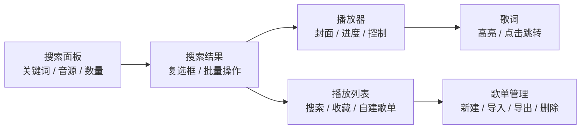
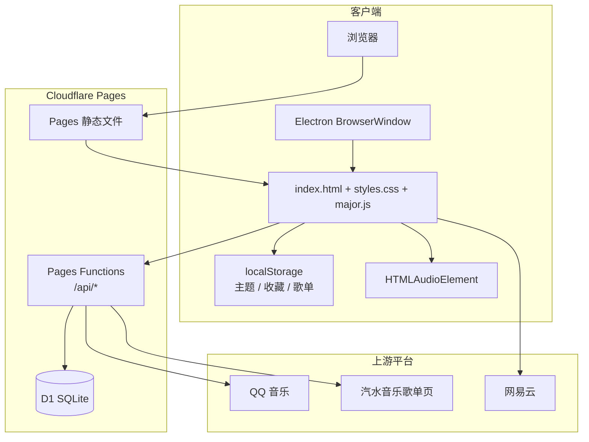
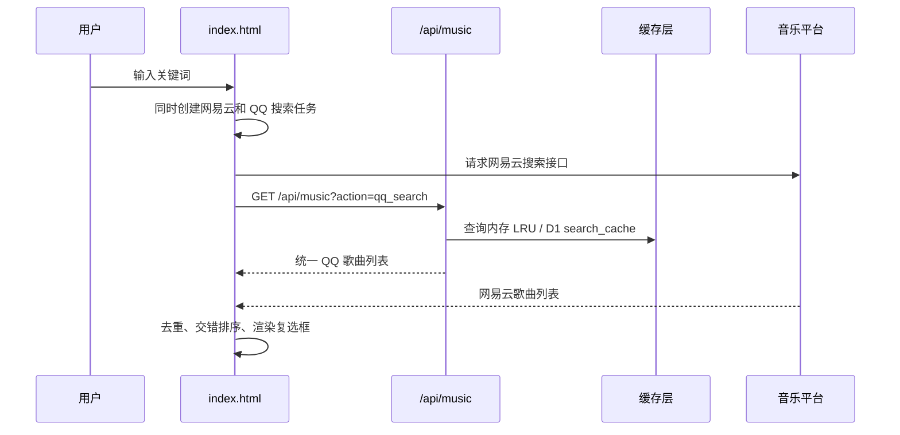
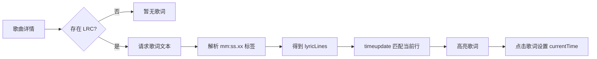

# HALO Music

<p align="center">
  
</p>

<p align="center"><strong>多音源搜索、在线播放、歌词同步与歌单管理</strong></p>

HALO Music 是一个基于 Cloudflare Pages、Pages Functions 和 D1 的在线音乐应用，同时提供 Electron 桌面客户端。它把多个平台的搜索结果统一成 HALO Track 数据结构，在浏览器端完成搜索、播放、歌词和歌单交互，在服务端负责鉴权、缓存、音频解析和公开歌单导入。

- 在线体验：<https://music.zhoujun.dev>
- 客户端下载：[Windows .exe](https://github.com/zhoujungis/halo_music/releases/latest/download/HALO-Music-Setup-x64.exe) · [Windows .msi](https://github.com/zhoujungis/halo_music/releases/latest/download/HALO-Music-Setup-x64.msi) · [Android .apk](https://github.com/zhoujungis/halo_music/releases/latest/download/HALO-Music.apk)
- GitHub：<https://github.com/zhoujungis/halo_music>

> 本项目用于学习、研究和演示。音乐内容、音频地址及相关版权归对应平台和原作者所有，请遵守当地法律、上游平台服务条款与版权政策。

## 目录

- [功能概览](#功能概览)
- [界面与交互](#界面与交互)
- [系统架构](#系统架构)
- [目录结构](#目录结构)
- [核心数据流](#核心数据流)
- [后端 API](#后端-api)
- [数据模型与持久化](#数据模型与持久化)
- [安全设计](#安全设计)
- [本地开发](#本地开发)
- [数据库初始化](#数据库初始化)
- [测试](#测试)
- [Electron 桌面端](#electron-桌面端)
- [Android 客户端](#android-客户端)
- [自动发布](#自动发布)
- [QQ 音频缓存定时刷新](#qq-音频缓存定时刷新)
- [配置与部署说明](#配置与部署说明)
- [常见问题](#常见问题)
- [限制与后续方向](#限制与后续方向)

## 功能概览

| 模块 | 能力 | 主要实现 |
| --- | --- | --- |
| 多源搜索 | 网易云、QQ 音乐；默认聚合搜索、结果去重；QQ 播放失效时按歌手、歌名和时长从哔哩哔哩补位 | `index.html`、`/api/music` |
| 播放器 | 播放/暂停、切歌、进度拖动、音量、静音、列表/单曲/随机播放 | `index.html` |
| 歌词 | LRC 时间轴解析、动态高亮、点击歌词跳转到时间点 | `index.html`、`/api/music` |
| 收藏 | 单曲收藏、搜索结果批量收藏、收藏列表 | `index.html`、`/api/library` |
| 自建歌单 | 新建、删除、导入、导出、添加/移除歌曲 | `index.html`、`/api/library` |
| 歌单导入 | 网易云、汽水音乐、QQ 音乐公开歌单链接，以及 HALO JSON | `functions/api/import-playlist.js` |
| 账号 | 邮箱验证码注册、Google 登录、登录/退出、30 天会话、D1 库同步；单 IP 限一个账号 | `functions/api/*.js`、`functions/api/auth/google/` |
| 管理 | `/admin` 管理面板，查看账号、会话、收藏和缓存概况 | `admin/`、`functions/api/admin.js` |
| 缓存 | 搜索缓存、音源解析缓存、内存 LRU、D1 二级缓存 | `functions/api/music.js`、`schema.sql` |
| 桌面端 | Electron 原生窗口、外链交给系统浏览器、Windows .exe/.msi/便携版 | `electron/`、`package.json` |
| Android | 轻量 WebView 客户端，加载线上站点 | `android/` |

## 界面与交互

### 桌面端布局

桌面端默认进入极简歌词视图，仅显示唱片动画和歌词。右上角“设置”可切换到搜索、我的歌单或播放列表工作区。



### 移动端布局

移动端通过底部导航切换“搜索 / 歌词 / 我的”。歌单概览使用卡片，进入歌单后显示可滚动歌曲列表；媒体查询会重新组织间距、按钮尺寸和滚动区域，而不是简单压缩桌面三栏。

### 交互规则

1. 搜索结果默认显示复选框；全选、收藏和歌单操作只作用于当前搜索结果。
2. 空结果时点击批量操作会提示暂无搜索结果；未选歌曲时会提示先选择歌曲。
3. 点击歌曲行会播放对应歌曲；点击歌词行会把 `audio.currentTime` 跳到该歌词的时间戳。
4. 未登录用户可以搜索、浏览并播放歌曲；收藏、歌单和个人信息需要登录后查看。
5. 登录用户的收藏和歌单先写入浏览器本地缓存，再异步同步到 D1，弱网时仍可使用本地数据。

## 系统架构



### 分层职责

- **展示层**：`index.html` 提供页面结构，`styles.css` 提供响应式 CSS，`major.js` 负责主题和国际化交互。
- **交互状态层**：运行时 `state` 保存搜索、播放、歌词、登录、收藏、歌单和批量选择状态。
- **音源适配层**：客户端和 `functions/api/music.js` 把不同平台字段归一化成歌曲对象。
- **鉴权层**：`_auth.js` 提供密码哈希、Cookie 会话、用户识别和统一 JSON 响应。
- **持久化层**：D1 存储用户、会话、云端歌单以及搜索/音频缓存；localStorage 提供本地兜底。
- **桌面壳层**：Electron 提供安全的原生窗口，不把 Node 能力暴露给页面。

## 目录结构

```text
.
├─ index.html                 # Pages 入口：页面结构
├─ major.js                  # 浏览器端运行时
├─ styles.css                 # 页面样式
├─ admin/                     # /admin 管理页面
├─ functions/api/
│  ├─ _auth.js                # PBKDF2、Cookie、会话校验、IP 哈希、JSON 响应
│  ├─ _email.js               # Resend 验证码邮件与验证码哈希
│  ├─ register.js             # POST /api/register（邮箱验证码注册）
│  ├─ email-code.js           # POST /api/email-code（Resend 发送验证码）
│  ├─ auth/google/
│  │  ├─ start.js             # GET /api/auth/google/start
│  │  └─ callback.js          # GET /api/auth/google/callback
│  ├─ login.js                # POST /api/login
│  ├─ admin.js                # GET /api/admin
│  ├─ logout.js               # POST /api/logout
│  ├─ me.js                   # GET /api/me
│  ├─ library.js              # GET/PUT /api/library
│  ├─ music.js                # 搜索、详情、音频解析、缓存和代理
│  └─ import-playlist.js      # POST /api/import-playlist
├─ electron/
│  ├─ main.cjs                # BrowserWindow 生命周期和安全策略
│  └─ preload.cjs             # contextBridge 暴露最小桌面信息
├─ android/                   # Android WebView 客户端与 Gradle 工程
├─ .github/workflows/
│  └─ release.yml             # 自动构建 Windows/Android 并更新 Release
├─ schema.sql                 # D1 表、索引和缓存表
├─ wrangler.toml              # Pages 与 D1 绑定配置
├─ _routes.json               # 仅将 /api/* 路由交给 Functions
├─ *test.js                   # Node 原生测试：鉴权、导入、播放和音源
├─ icon.svg                   # 应用图标
└─ package.json               # npm、Wrangler、Electron 和打包脚本
```

## 核心数据流

### 搜索流程



### 播放流程

1. 点击歌曲行后，页面更新 `state.currentTrack` 和 `state.playContext`。
2. 客户端检查已有详情、音频地址和预加载的下一首歌曲。
3. 需要服务端解析时请求 `/api/music?action=qq_audio`。
4. 服务端优先复用缓存并验证候选音频；失败时客户端可刷新解析或切换备用音源。
5. 最终 URL 设置到 `<audio>`，`timeupdate` 同步驱动进度条、歌词高亮和当前歌曲样式。

### 歌词流程



## 后端 API

所有 Functions 位于 `functions/api/`，由 Cloudflare Pages 按文件名映射为 `/api/*`。搜索、详情解析和音频播放是公开能力；用户库、账号和听歌记录接口要求有效的 `hm_token` 会话 Cookie。

| 方法 | 路径 | 是否登录 | 作用 |
| --- | --- | --- | --- |
| `POST` | `/api/email-code` | 否 | 通过 Resend 发送注册验证码（60 秒冷却、限流） |
| `POST` | `/api/register` | 否 | 校验邮箱验证码并创建账号，返回会话 Cookie |
| `POST` | `/api/cache-refresh` | Bearer | 重新解析并刷新 D1 中已有 QQ 歌曲的音频缓存 |
| `GET` | `/api/auth/google/start` | 否 | 跳转 Google OAuth 授权页 |
| `GET` | `/api/auth/google/callback` | 否 | 处理 Google 回调、创建或关联账号并登录 |
| `POST` | `/api/login` | 否 | 校验账号密码并创建会话 |
| `POST` | `/api/logout` | 否 | 删除当前会话并清理 Cookie |
| `GET` | `/api/me` | 否 | 返回当前用户名，未登录返回 401 |
| `GET` | `/api/library` | 是 | 读取当前用户收藏和歌单 |
| `PUT` | `/api/library` | 是 | 校验并覆盖用户收藏和歌单 |
| `POST` | `/api/import-playlist` | 是 | 服务端解析公开歌单分享链接 |
| `GET` | `/api/music` | 否 | 搜索、详情、音频解析、代理和缓存 |

### `/api/music` 常用 action

| `action` | 主要参数 | 说明 |
| --- | --- | --- |
| `qq_search` | `q`, `limit` | QQ 音乐搜索，含官方接口和备用源 |
| `qq_detail` | `id` 及音源字段 | 获取详情、封面、歌词或可播放信息 |
| `qq_audio` | `id`, `duration`, `refresh` | 解析并验证可播放音频 |
| `bili_search` | `q`, `title`, `artist`, `duration` | QQ 音频失效时搜索匹配的哔哩哔哩视频 |
| `bili_audio` | `bvid`/`aid`, `page`, `duration` | 代理匹配视频的可播放音频流 |

服务端会限制关键词长度、返回数量和上游请求时间，避免单个平台异常拖垮整次请求。

管理面板使用 `ADMIN_USERNAME`（或逗号分隔的 `ADMIN_USERNAMES`）作为管理员白名单。默认配置为 `admin`；请先在 D1 中为该用户名建立账号，再访问 `/admin`。

## 数据模型与持久化

### HALO Track

```js
{
  uid: "qq-歌曲标识",
  source: "qq",                 // netease / qq（QQ 失效时运行时切换 bilibili）
  title: "歌曲名",
  artist: "歌手",
  album: "专辑",
  cover: "https://...",
  songid: "平台歌曲 ID",
  quality: "lossless",
  qualityLabel: "无损",
  pay: "",
  audioUrl: null,                // 运行时字段，不写入云端库
  lrc: null                      // 运行时歌词，不写入云端库
}
```

`serializeTrack()` 会过滤短时效音频 URL、歌词和详情状态，只保存可复用的标识与展示字段，避免把临时资源写入 localStorage 或 D1。

### D1 表

| 表 | 关键字段 | 用途 |
| --- | --- | --- |
| `user` | `username`, `email`, `display_name`, `avatar_url`, `google_sub`, `password_hash`, `password_salt`, `last_login_at` | 账号、邮箱、Google 绑定、密码材料与最后登录时间（UTC+8 展示） |
| `music_sessions` | `token`, `username`, `expires_at` | 30 天登录会话 |
| `music_libraries` | `username`, `library_json`, `updated_at` | 用户收藏和自建歌单 JSON |
| `email_verification_codes` | `email`, `purpose`, `code_hash`, `request_ip`, `expires_at`, `attempts` | 一次性邮箱验证码（只存哈希） |
| `registration_ips` | `ip_hash`, `username`, `created_at` | 单 IP 单账号限制 |
| `auth_rate_limits` | `key`, `window_started_at`, `count` | 验证码发送频率限制 |
| `music_play_history` | `username`, `track_uid`, `title`, `played_at` | 听歌历史与总结 |
| `music_cache` | `key`, `value_json`, `expires_at` | 音频/详情共享缓存 |
| `search_cache` | `key`, `value_json`, `expires_at` | 搜索结果短期缓存 |

### 缓存策略

- 内存层使用 `Map` 实现 LRU，最多保留约 500 个条目。
- 搜索缓存默认约 45 秒，吸收短时间内的重复搜索。
- 音频解析缓存默认按较长周期保存；失效时可用 `refresh=1` 重新解析。
- D1 是跨请求、跨 Worker 实例的共享缓存层；过期数据按惰性策略清理。
- 用户库采用“localStorage 先落地、D1 异步同步”，兼顾离线和多设备使用。

## 安全设计

### 账号与会话

- 用户名限制为 3–20 位字母、数字、下划线或中文。
- 密码至少 8 位。
- 使用 Web Crypto PBKDF2-SHA-256、100,000 次迭代和 16 字节随机 salt。
- 服务端只保存哈希和 salt，不保存明文密码。
- 会话 token 使用随机 UUID，写入 `HttpOnly; Secure; SameSite=Lax` Cookie。
- 会话默认有效期 30 天，过期访问会清理数据库记录。

### 注册与登录

- 邮箱注册先请求 `/api/email-code`，服务端通过 Resend 发送 6 位验证码；验证码 10 分钟有效、最多尝试 5 次，数据库只保存 `SHA-256(email:code)`。
- 同一邮箱 60 秒内不可重复发送，滚动 1 小时内最多 5 次；同一来源 IP 每小时最多 10 次。
- `registration_ips` 以哈希形式记录首次注册 IP，邮箱注册和 Google 首次建号都会检查，确保一个 IP 只能创建一个账号。注销账号时会释放该记录。
- Google 登录使用服务端 OAuth 2.0 授权码流程，`state` 通过短期 HttpOnly Cookie 校验；只接受 Google 标记为已验证的邮箱。
- Google 邮箱与已有邮箱账号一致时会自动关联；Google 新用户会生成唯一用户名，并同样受单 IP 限制。

### Electron 安全边界

`BrowserWindow` 配置了 `contextIsolation: true`、`nodeIntegration: false` 和 `sandbox: true`。Preload 只通过 `contextBridge` 暴露平台名和 Electron 版本；外部链接交给系统默认浏览器打开。

## 本地开发

### 环境要求

- Node.js 20 LTS 或更高版本
- npm
- Cloudflare Wrangler 4（已包含在开发依赖中）
- Windows 桌面打包需要 Electron Builder 支持的 Windows 环境

### 安装依赖

```powershell
npm install
```

### 启动本地 Pages

先初始化本地 D1：

```powershell
npx wrangler d1 execute halo-music-db --local --file schema.sql
```

然后启动 Pages 和 Functions：

```powershell
npm run dev
```

打开 Wrangler 输出的本地地址即可访问。注册需要在项目根目录的 `.dev.vars` 中配置 Resend 与 Google OAuth 凭据（该文件已被 `.gitignore` 忽略）：

```ini
# Resend 密钥（必须）
RESEND_API_KEY=re_xxxxxxxx
# 以下两项已在 wrangler.toml [vars] 里预配置，通常无需重复
# RESEND_FROM=no-reply@music.zhoujun.dev
# RESEND_SENDER_NAME="HALO Music"
GOOGLE_CLIENT_ID=xxxxxxxx.apps.googleusercontent.com
GOOGLE_CLIENT_SECRET=xxxxxxxx
# 可选；默认使用 <当前域名>/api/auth/google/callback
GOOGLE_REDIRECT_URI=http://localhost:8788/api/auth/google/callback
# 可选；用于给注册 IP 哈希加 pepper
AUTH_SECRET=change-me
# 可选；QQ 缓存定时刷新接口的 Bearer token
CACHE_REFRESH_TOKEN=change-me
```

Google Cloud Console 的 OAuth 客户端需要把 `http://localhost:8788/api/auth/google/callback` 和线上 `https://music.zhoujun.dev/api/auth/google/callback` 加入授权重定向 URI。只要配置 `RESEND_API_KEY`，验证码邮件就会使用已验证的 `no-reply@music.zhoujun.dev` 发件；Google 登录需要 `GOOGLE_CLIENT_ID` 和 `GOOGLE_CLIENT_SECRET`。未配置对应变量时，邮箱注册或 Google 登录会返回明确的未配置提示，账号密码登录仍然可用。

## 数据库初始化

创建远程 D1 并记录返回的 `database_id`：

```powershell
npx wrangler d1 create halo-music-db
```

把 ID 写入 `wrangler.toml`，再初始化远程表：

```powershell
npx wrangler d1 execute halo-music-db --remote --file schema.sql
```

`wrangler.toml` 的核心绑定如下：

```toml
name = "halo-music"
compatibility_date = "2025-01-01"
pages_build_output_dir = "."

[[d1_databases]]
binding = "DB"
database_name = "halo-music-db"
database_id = "替换为你的 D1 database_id"
```

音源地址通过 Cloudflare Pages 的环境变量配置，不写入前端代码。变量值支持
逗号或换行分隔的多个地址，服务端会按顺序尝试，某个上游超时或失效会自动切换：

```toml
[vars]
QQ_SOURCE_URLS = "https://your-qq-source.example/search,https://your-qq-backup.example/search"
NETEASE_SOURCE_URLS = "https://musicapi.qijieya.cn/meting,https://your-netease-backup.example/meting"
```

注册相关变量属于密钥，不要提交到仓库。生产环境请在 Pages 控制台设置，或使用：

```powershell
npx wrangler pages secret put RESEND_API_KEY
npx wrangler pages secret put RESEND_FROM
npx wrangler pages secret put GOOGLE_CLIENT_ID
npx wrangler pages secret put GOOGLE_CLIENT_SECRET
npx wrangler pages secret put AUTH_SECRET
```

升级已有数据库时，按顺序执行 `migrations/` 下的 SQL（至少需要 `0005_accounts_and_listening_history.sql` 与 `0006_auth_registration.sql`）：

```powershell
npx wrangler d1 execute halo-music-db --remote --file migrations/0005_accounts_and_listening_history.sql
npx wrangler d1 execute halo-music-db --remote --file migrations/0006_auth_registration.sql
```

生产环境建议在 Pages 控制台设置同名变量，避免把具体第三方地址提交到仓库。

## 测试

项目使用 Node.js 原生 `node:test`：

```powershell
npm test
```

测试覆盖：

- 登录、会话和登出数据库流程
- 邮箱规范化、用户名校验、注册 IP 哈希和验证码哈希
- 收藏和自建歌单按用户持久化
- 网易云、QQ、汽水音乐字段归一化
- 歌单分享链接识别与导入
- QQ 签名算法和分页请求体
- LRC 时间标签清洗与歌词切分
- 音频容器识别、时长估算和播放上下文切歌
- 浏览器端内联脚本语法检查

提交前还可以检查补丁格式：

```powershell
git diff --check
```

## Electron 桌面端

桌面客户端使用原生窗口加载 Pages 应用，不重复实现一套播放器：

```text
Electron main process
        │
        ├─ BrowserWindow（默认 1440×920，最小 960×640）
        ├─ preload.cjs（最小化 contextBridge）
        └─ loadURL(HALO_MUSIC_URL 或 https://music.zhoujun.dev)
```

启动开发窗口：

```powershell
npm run desktop:dev
```

构建 Windows NSIS / MSI / 便携版：

```powershell
npm run desktop:all
```

构建单独的便携版：

```powershell
npm run desktop:portable
```

产物写入 `release/`：

- `HALO-Music-Setup-x64.exe`：NSIS 安装包
- `HALO-Music-Setup-x64.msi`：MSI 安装包
- `HALO-Music-Portable-x64.exe`：便携版

应用 ID 为 `com.halomusic.desktop`，产品名为 `HALO Music`，图标来自 `icon-512.png`。CI 默认构建未签名版本；如需签名，配置 `CSC_LINK` 和 `CSC_KEY_PASSWORD`。

## Android 客户端

`android/` 是一个轻量 WebView 壳，直接加载 `https://music.zhoujun.dev`，不重复打包前端资源。需要 JDK 17 和 Android SDK 34：

```powershell
gradle -p android assembleDebug -PhaloVersionName=2.0.0 -PhaloVersionCode=20000
```

产物位于 `android/app/build/outputs/apk/debug/app-debug.apk`。CI 会把它重命名为 `HALO-Music-<version>.apk` 和稳定的 `HALO-Music.apk` 上传到 Release。

## 自动发布

`.github/workflows/release.yml` 在 push 到 `main` 或手动触发时运行：

1. 读取 `package.json` 当前版本；如果对应 tag 已存在，自动递增 patch（例如 `2.0.0` → `2.0.1`）
2. 提交版本变更并创建新的 `v<version>` tag
3. `windows-latest` 构建 `.exe`、`.msi`、便携版和 `latest.yml`
4. `ubuntu-latest` 构建 Android APK
5. 创建或更新 GitHub Release 并上传全部资产
6. 如果配置了 `CLOUDFLARE_API_TOKEN` secret，同时部署 Cloudflare Pages；未配置时自动跳过

每次 push 都会产生新的 patch 版本和 tag。需要 minor/major 版本时，手动修改 `package.json` 版本后再推送；工作流会使用该版本创建 tag。工作流会同步更新 `package-lock.json`、`wrangler.toml` 和 `index.html` 中的版本号。

## QQ 音频缓存定时刷新

`.github/workflows/refresh-qq-cache.yml` 每隔约 20 天运行一次（cron `0 19 */20 * *`，即北京时间 03:00，落在 1/21/31 日）：

1. 从 D1 的收藏、自建歌单和听歌历史中提取 QQ 歌曲 mid
2. 调用受保护的 `POST /api/cache-refresh`
3. 服务端以 `refresh=1` 重新解析并覆盖 `music_cache` 中的音频地址

需要在 GitHub 和 Cloudflare Pages 两处配置相同的 `CACHE_REFRESH_TOKEN` secret。也可以手动触发：

```powershell
gh workflow run refresh-qq-cache.yml
```

## 配置与部署说明

本 README 记录配置方式。`npm run deploy` 不会自动执行；客户端安装包由 GitHub Actions 自动构建并更新 Release。项目脚本如下：

| 命令 | 作用 |
| --- | --- |
| `npm run dev` | Wrangler Pages 本地开发 |
| `npm run deploy` | 部署 Pages（需要明确执行） |
| `npm test` | 执行 Node 原生测试 |
| `npm run desktop:dev` | 启动 Electron 开发窗口 |
| `npm run desktop:all` | 构建 Windows NSIS/MSI/便携版 |
| `npm run desktop:portable` | 构建 Windows 便携版 |
| `gradle -p android assembleDebug` | 构建 Android APK |

Electron 地址可以通过环境变量覆盖：

```powershell
$env:HALO_MUSIC_URL = "https://music.zhoujun.dev"
npm run desktop:dev
```

也可以使用命令行参数：

```powershell
npx electron . --url=https://music.zhoujun.dev
```

## 常见问题

### 为什么收藏和歌单需要登录？

搜索、浏览和播放是公开能力；收藏、歌单和个人信息需要登录。打开登录弹窗后可以使用邮箱验证码注册、Google 账号登录，或使用已有账号密码登录。每个 IP 只能注册一个账号；如果当前网络已注册过，请直接登录原账号。

### 为什么收藏刷新后还在，但另一台设备没有？

未登录时不展示收藏和歌单；登录后收藏与歌单会同步到 `/api/library`，不同设备需要使用同一账号。

### 为什么导入 QQ 歌单数量有限？

服务端为了控制请求时间、上游压力和 Pages Function 限制，QQ 歌单最多导入前 1,200 首；网易云最多处理 2,000 首，汽水音乐页面解析上限为 4 MB。

### 为什么播放地址不能永久保存？

部分平台返回的是短时效地址。项目保存平台歌曲标识和已验证候选信息，不把临时音频 URL 当作永久资源；播放失败时会重新解析。

### D1 报“binding 缺失”怎么办？

检查 `wrangler.toml` 是否存在 `[[d1_databases]]`、`binding` 是否为 `DB`，并确认本地或远程 D1 已执行 `schema.sql`。

### 如何确认没有部署？

`npm run deploy` 是独立脚本，不会被 `npm test`、`npm run dev` 或编辑 README 自动调用。查看 Git 工作区和 Wrangler 输出即可确认本次是否发生外部部署。

## 限制与后续方向

1. 上游平台接口、字段和音频地址可能变化，需要持续维护适配器和备用源。
2. Pages Functions 的请求时间和上游限流会影响大批量搜索、歌词和歌单导入。
3. 当前前端主入口仍集中在 `index.html`，后续可以拆分为模块化组件、状态模块和样式文件。
4. 当前自动化测试以协议、解析和状态逻辑为主，后续可以加入 Playwright 视觉回归基线。
5. 用户库目前以 JSON 保存；若要支持协作歌单、增量同步或审计，可拆分为歌曲、歌单和关系表。
6. 单 IP 注册限制在校园/公司 NAT 下可能误伤其他用户；后续可用 Captcha 或邀请码替代硬性限制。
7. 播放解析限流目前是 Worker 实例内的内存桶；高流量场景建议叠加 Cloudflare Rate Limiting 规则。

## 许可证与第三方声明

项目许可证见 [LICENSE](LICENSE)。

### Tests and signing

Run `npm test` to execute the repository tests under `tests/`. Search actions
remain public, while playback and detail actions under `/api/music` are
rate-limited by client IP. Release builds are unsigned unless `CSC_LINK` and
`CSC_KEY_PASSWORD` are configured in GitHub Actions secrets.

Set `HALO_MUSIC_VERSION` in the Pages environment (and `wrangler.toml`) for each
release so the Android update endpoint stays aligned with the GitHub Release.
